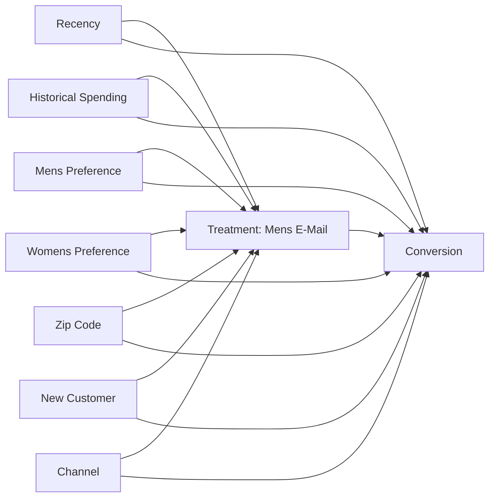

# Day 5 - Causal DAG and Identification Assumptions

## 1. Purpose

This document describes the proposed causal structure for the Hillstrom email-marketing analysis used in EconoCausal.

The analysis compares Mens E-Mail customers with No E-Mail customers and studies the outcome of customer conversion.

**Scope limitation:** Hillstrom evaluates email-marketing interventions, not assigned discounts or product-price changes. The results must not be interpreted as the causal effect of changing prices or offering discounts.

## 2. Treatment and Outcome Definitions

| Component               | Definition                       |
| ----------------------- | -------------------------------- |
| Dataset                 | Hillstrom Email Marketing        |
| Treatment variable      | `treatment`                      |
| Treatment group         | Mens E-Mail                      |
| Control group           | No E-Mail                        |
| Treatment coding        | 1 = Mens E-Mail, 0 = No E-Mail   |
| Outcome variable        | `outcome`                        |
| Original outcome column | `conversion`                     |
| Outcome coding          | 1 = Converted, 0 = Not converted |
| Analysis sample         | 42,613 observations              |

The Womens E-Mail group is excluded from this particular binary treatment comparison.

## 3. Covariates Used by Section A

The Section A DML notebook uses these seven pre-treatment customer characteristics:

| Variable   | Description                           |
| ---------- | ------------------------------------- |
| `recency`  | Customer's recency measure            |
| `history`  | Historical customer spending measure  |
| `mens`     | Previous mens merchandise indicator   |
| `womens`   | Previous womens merchandise indicator |
| `zip_code` | Customer geographic category          |
| `newbie`   | New-customer indicator                |
| `channel`  | Customer channel category             |

Categorical variables `zip_code` and `channel` are one-hot encoded before model fitting.

These variables are treated as candidate pre-treatment covariates based on the Section A notebook. Their timing and causal roles should be confirmed against the original experiment documentation.

## 4. Proposed Causal DAG

The following is a provisional observational identification diagram. It represents the possibility that observed customer characteristics are associated with both treatment assignment and conversion.

**Important:** This diagram is a working assumption for reviewing possible confounding paths. The available Section A notebook does not explicitly document the original treatment-randomization protocol. Therefore, the arrows from customer characteristics to treatment must not be treated as verified facts.

If the original experiment confirms randomized assignment, the DAG should be revised to remove the covariate-to-treatment arrows. Baseline covariates may still predict conversion.

## 5. Identification Assumptions

### Treatment Definition

The intervention is Mens E-Mail compared with No E-Mail. Womens E-Mail observations are excluded from this binary comparison.

### Outcome Definition

The primary outcome is customer conversion, represented by the binary `conversion` variable.

### Conditional Exchangeability

After accounting for relevant pre-treatment covariates, there should be no important unmeasured common causes of treatment and conversion.

This assumption cannot be established using the DML model or refutation tests alone.

### Positivity / Overlap

Customers with comparable covariate profiles should have a non-zero probability of belonging to either the treatment or control group.

A dedicated overlap diagnostic is required before treating this assumption as verified.

### Consistency

The recorded treatment should correspond to the defined Mens E-Mail or No E-Mail intervention.

### Temporal Validity

Only variables measured before treatment should be used as baseline covariates. Post-treatment variables must not be adjusted for as ordinary confounders.

### Data Quality

Duplicates, missing values, invalid records, and variable types should be checked. The Hillstrom duplicate records require investigation before any decision to remove them.

## 6. Estimation Approach

Section A uses EconML LinearDML with:

- Random Forest Regressor for the outcome nuisance model.
- Random Forest Classifier for the treatment nuisance model.
- Three-fold cross-fitting.
- Selected pre-treatment customer covariates.
- Binary treatment and binary conversion outcome.

The model estimates the average and conditional treatment effects for the selected Mens E-Mail versus No E-Mail comparison.

DML does not automatically guarantee causal identification. Interpretation depends on the validity of the treatment definition, covariates, and identification assumptions.

## 7. Supporting Causal Robustness Checks

The project also contains DoWhy refutation results:

- Random Common Cause
- Placebo Treatment
- Data Subset (80%)

These checks provide sensitivity evidence. They do not prove that all confounding has been eliminated or that the causal assumptions are satisfied.

## 8. Known Limitations

1. The original randomization protocol has not yet been verified from the available notebook documentation.
2. The proposed DAG is provisional until the experiment design is confirmed.
3. Overlap and covariate balance require appropriate diagnostic review.
4. Hillstrom measures email-marketing interventions, not discount assignment.
5. Online Retail price and quantity relationships remain descriptive without a defensible pricing identification strategy.
6. Historical revenue-based budget allocation must not be described as causal ROI optimization.

## 9. Ownership and Review

- Section A: Confirm experiment design, treatment assignment, outcome, covariates, and final causal DAG.
- Section B: Maintain methodology documentation and communicate assumptions and limitations through the dashboard.

## 10. Completion Status

- [x] Treatment and outcome definitions documented from Section A.
- [x] DML covariates documented.
- [x] Provisional causal DAG prepared.
- [x] Identification assumptions documented.
- [x] Dataset and causal limitations recorded.
- [ ] Original randomization protocol confirmed.
- [ ] Final DAG approved by Section A.
- [ ] Overlap and covariate balance diagnostics reviewed.

**Status:** Documentation prepared; final causal identification review remains pending.
